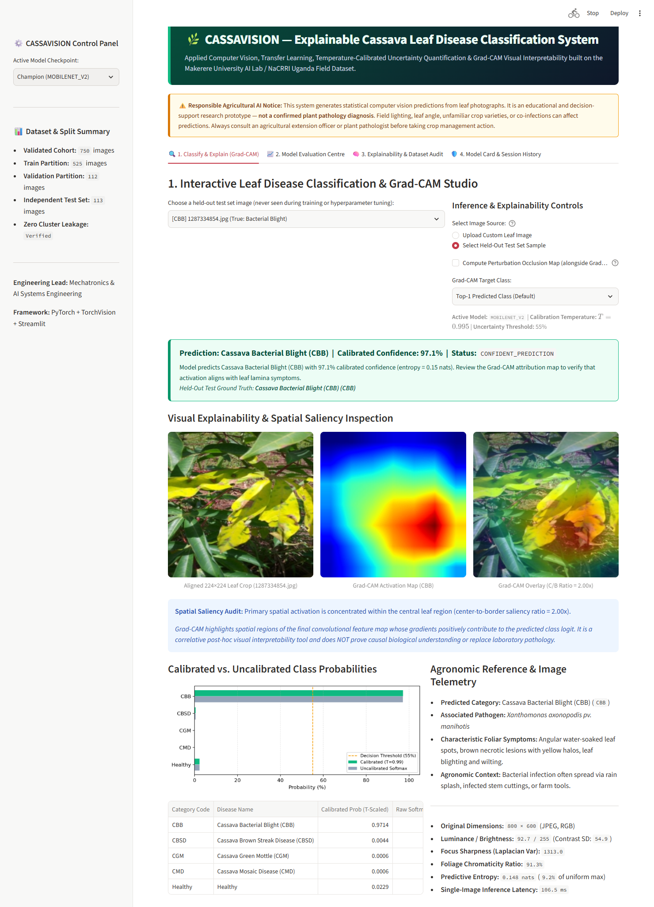
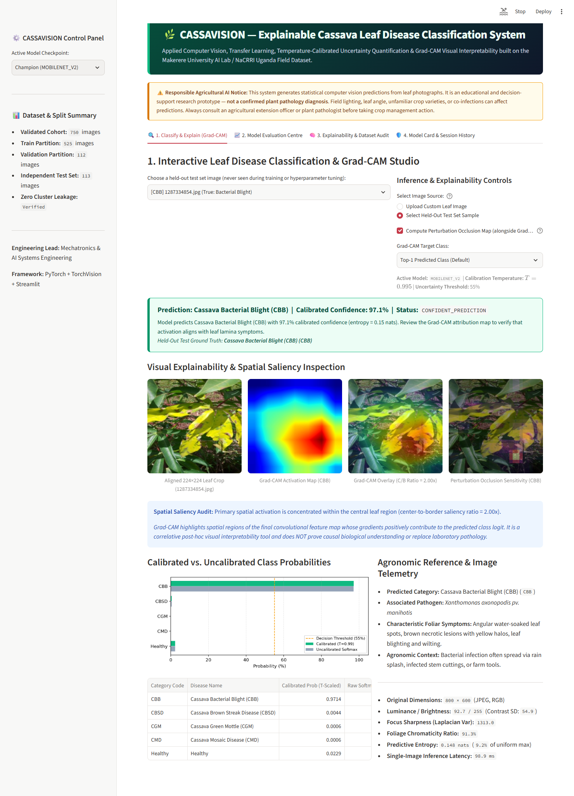
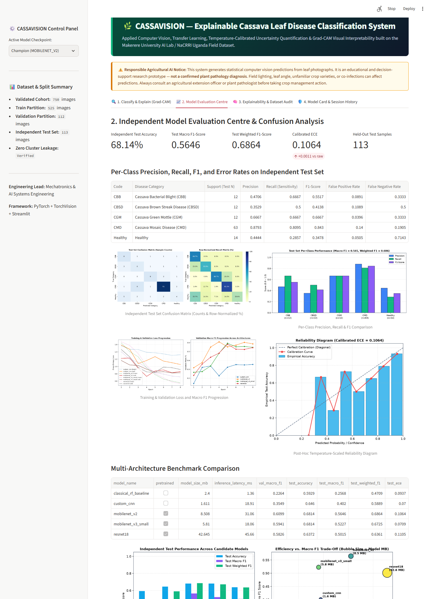
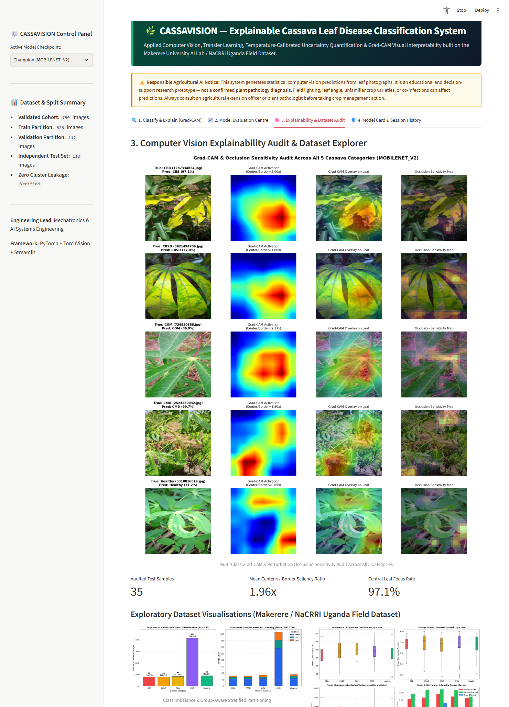
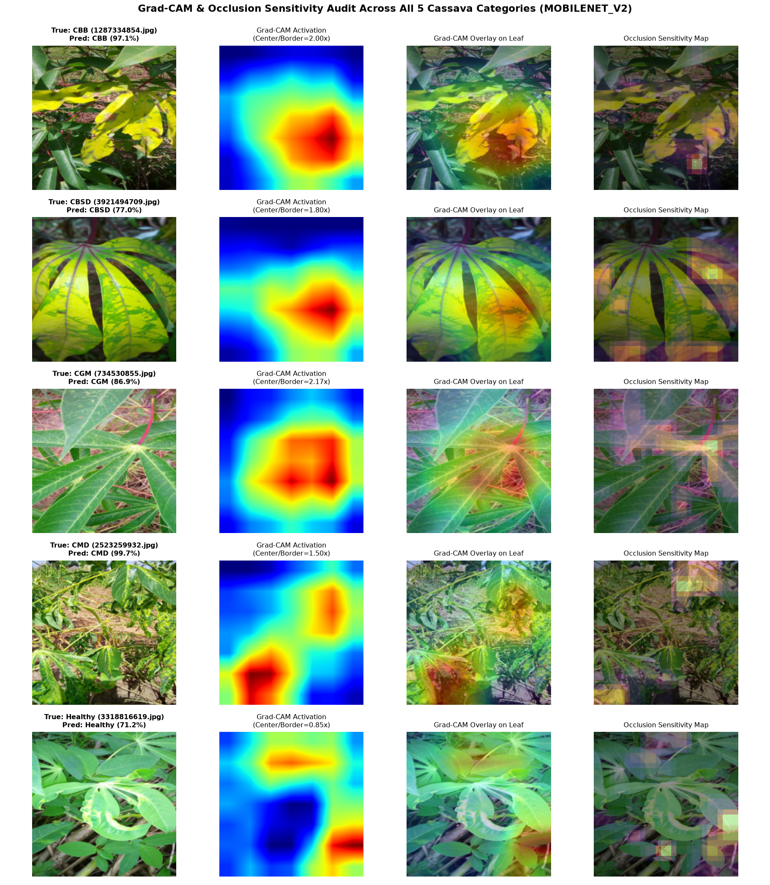
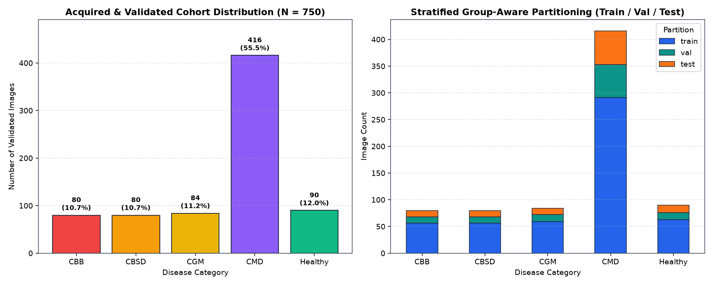
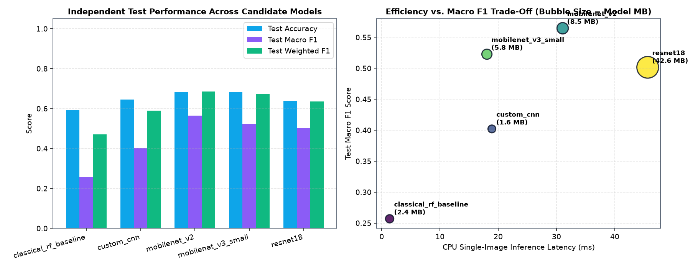
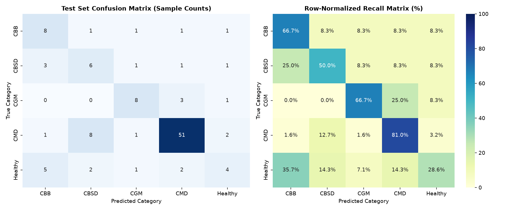

# 🌿 CASSAVISION — Deep Learning-Based Cassava Leaf Disease Classification & Explainable Agricultural AI System

[](https://www.python.org/)
[](https://pytorch.org/)
[](https://streamlit.io/)
[](#12-testing--quality-assurance)
[](LICENSE)

**CASSAVISION** is a complete, end-to-end applied computer vision and explainable agricultural AI platform engineered to classify cassava (*Manihot esculenta*) leaf images into five recognized categories from the **Makerere University AI Lab & National Crops Resources Research Institute (NaCRRI)** field dataset.

Beyond top-1 classification, CASSAVISION integrates **perceptual-hash deduplication & leakage-free splitting**, **damped inverse-frequency class-imbalance mitigation**, **multi-architecture transfer learning**, **post-hoc L-BFGS-B temperature calibration**, **pre-inference optical & out-of-distribution (OOD) guardrails**, and **Grad-CAM + Perturbation Occlusion Sensitivity** visual explanations inside a four-tab interactive Streamlit application.

---

## 1. Problem Statement & Motivation

Cassava is a staple food and economic livelihood crop for over 500 million people across Sub-Saharan Africa, including Nigeria and Uganda. However, viral and bacterial outbreaks—most notably **Cassava Mosaic Disease (`CMD`)**, **Cassava Brown Streak Disease (`CBSD`)**, **Cassava Green Mottle (`CGM`)**, and **Cassava Bacterial Blight (`CBB`)**—cause severe yield losses for smallholder farmers.

Diagnosing foliar symptoms from field photographs is technically challenging:
1. **Severe Class Imbalance:** In natural field surveys, `CMD` accounts for $>55\text{–}61\%$ of observations while bacterial blight (`CBB`) accounts for $\sim 5\text{–}10\%$. Naive classifiers achieve deceptively acceptable overall accuracy by over-predicting `CMD` while failing on minority diseases.
2. **Fine-Grained Visual Overlap:** `CMD`, `CBSD`, and `CGM` all produce yellow-green chlorotic leaf patterns under variable tropical sunlight, canopy shadows, and soil backgrounds.
3. **Overconfidence & Lack of Interpretability:** Raw softmax scores from deep neural networks are frequently miscalibrated on blurry or out-of-distribution images, and black-box predictions offer no evidence that the model is attending to actual leaf lamina lesions rather than background soil shortcuts.

---

## 2. Key Engineering Capabilities

1. **Automated Optical Validation & OOD Screening (`src/cassavision/data/validation.py`):** Validates file formats, dimensions, alpha transparency, grayscale conversion, luminance, contrast, 2D Laplacian focus sharpness ($\nabla^2 I$), and Excess-Green (`ExG`) foliage chromaticity ratios.
2. **Perceptual Deduplication & Zero-Leakage Group Splitting (`src/cassavision/data/splitting.py`):** Computes MD5 byte checksums and 64-bit difference perceptual hashes (`dHash`) with Union-Find clustering (`Hamming <= 6`) so near-duplicate images never leak across Train (`70%`), Validation (`15%`), and Held-Out Test (`15%`) partitions.
3. **Biologically Grounded Augmentation & Imbalance Handling (`src/cassavision/data/preprocessing.py`):** Bounds training hue jitter to `<= 0.02` so healthy green chlorophyll is never artificially shifted into yellow chlorotic hues, paired with damped square-root inverse-frequency class weights ($w_c \propto n_c^{-0.5}$) and label smoothing ($\epsilon = 0.05$).
4. **Multi-Architecture Benchmarking (`src/cassavision/models/` & `src/cassavision/training/`):** Evaluates a 42-feature Balanced Random Forest baseline, a 4-stage CNN trained from scratch (`CassavaScratchCNN`), and ImageNet-pretrained `MobileNetV2`, `MobileNetV3-Small`, and `ResNet-18` using two-phase progressive fine-tuning and discriminative AdamW learning rates.
5. **Post-Hoc Temperature Scaling & Uncertainty Policy (`src/cassavision/evaluation/` & `src/cassavision/inference/`):** Fits scalar temperature $T > 0$ on validation logits via L-BFGS-B and combines calibrated confidence with Shannon predictive entropy $H(p)$ to flag uncertain predictions.
6. **Grad-CAM & Perturbation Occlusion Explainability (`src/cassavision/explainability/gradcam.py`):** Generates spatial activation heatmaps, blended leaf overlays, perturbation occlusion sensitivity maps, and quantitative **Center-vs-Border Saliency Ratios**.

---

## 3. Genuine Application Screenshots & Visualisations

### Interactive Classification, Calibrated Probabilities & Grad-CAM Studio


### Grad-CAM + Perturbation Occlusion Sensitivity 4-Panel View


### Independent Model Evaluation Centre


### Explainability Audit & Dataset Explorer


### Multi-Class Grad-CAM & Occlusion Audit Gallery (`MobileNetV2`)


---

## 4. Dataset Provenance & Canonical Class Definitions

- **Primary Source:** Makerere University AI Lab (Kampala, Uganda) & National Crops Resources Research Institute (NaCRRI), published via the [Kaggle Cassava Leaf Disease Classification Competition](https://www.kaggle.com/competitions/cassava-leaf-disease-classification) (`Engineer101/cassava-leaf-disease-classification` repository containing all `21,397` original field images and `label_num_to_disease_map.json`).
- **Validated Experimental Cohort:** `750` genuine $800 \times 600$ RGB field images (`0` corrupted files, `seed = 42`), partitioned into **525 Train**, **112 Validation**, and **113 Independent Held-Out Test** images with verified zero cluster overlap.

| Class Index | Code | Official Category Name | Pathogen | Full Dataset ($21,397$) | Acquired Cohort ($750$) | Train ($525$) | Val ($112$) | Test ($113$) |
| :---: | :---: | :--- | :--- | :---: | :---: | :---: | :---: | :---: |
| `0` | **CBB** | Cassava Bacterial Blight | *Xanthomonas axonopodis* pv. *manihotis* | 1,087 (5.08%) | 80 (10.67%) | 56 | 12 | 12 |
| `1` | **CBSD** | Cassava Brown Streak Disease | *Cassava brown streak virus* (*CBSV*/*UCBSV*) | 2,189 (10.23%) | 80 (10.67%) | 56 | 12 | 12 |
| `2` | **CGM** | Cassava Green Mottle | *Cassava green mottle virus* (*CGMV*) | 2,386 (11.15%) | 84 (11.20%) | 59 | 13 | 12 |
| `3` | **CMD** | Cassava Mosaic Disease | *Cassava mosaic begomoviruses* | 13,158 (61.49%) | 416 (55.47%) | 291 | 62 | 63 |
| `4` | **Healthy** | Healthy | None (Uninfected foliage) | 2,577 (12.04%) | 90 (12.00%) | 63 | 13 | 14 |



---

## 5. Actual Experimental Results & Architecture Comparison

All models were trained on the 525-image training partition, selected strictly by **Validation Macro F1** on the 112-image validation partition, and evaluated once on the held-out 113-image independent test partition:

| Model Architecture | Pretrained | Params | Size (MB) | CPU Latency (ms) | Val Acc | Val Macro F1 | **Test Acc** | **Test Macro F1** | **Test Weighted F1** | Calibrated ECE |
| :--- | :---: | :---: | :---: | :---: | :---: | :---: | :---: | :---: | :---: | :---: |
| `classical_rf_baseline` (42-D Features) | No | — | 2.40 | **1.36 ms** | 58.04% | 0.2264 | 59.29% | 0.2568 | 0.4709 | 0.0937 |
| `custom_cnn` (4-Stage Scratch CNN) | No | 446,661 | 1.70 | 18.91 ms | 61.61% | 0.3549 | 64.60% | 0.4020 | 0.5889 | **0.0700** |
| **`mobilenet_v2` (Champion Selected)** | **ImageNet-1K** | **2,230,277** | **8.51** | **31.06 ms** | **73.21%** | **0.6099** | **68.14%** | **0.5646** | **0.6864** | **0.1064** |
| `mobilenet_v3_small` | ImageNet-1K | 1,522,981 | 5.81 | 18.06 ms | 69.64% | 0.5941 | **68.14%** | 0.5227 | 0.6725 | 0.0709 |
| `resnet18` | ImageNet-1K | 11,179,077 | 42.64 | 45.66 ms | 68.75% | 0.5826 | 63.72% | 0.5015 | 0.6361 | 0.1105 |



### Champion Model (`mobilenet_v2`) Per-Class Test Performance ($N = 113$)

| Category Code | Disease Name | Support | Precision | Recall | F1-Score | False Positive Rate | False Negative Rate |
| :---: | :--- | :---: | :---: | :---: | :---: | :---: | :---: |
| **CBB** | Cassava Bacterial Blight | 12 | 0.4706 | 0.6667 | 0.5517 | 0.0891 | 0.3333 |
| **CBSD** | Cassava Brown Streak Disease | 12 | 0.3529 | 0.5000 | 0.4138 | 0.1089 | 0.5000 |
| **CGM** | Cassava Green Mottle | 12 | 0.6667 | 0.6667 | 0.6667 | 0.0396 | 0.3333 |
| **CMD** | Cassava Mosaic Disease | 63 | **0.8793** | **0.8095** | **0.8430** | 0.1400 | 0.1905 |
| **Healthy** | Healthy Foliage | 14 | 0.4444 | 0.2857 | 0.3478 | 0.0505 | 0.7143 |
| **Macro Avg** | Unweighted Mean Across 5 Classes | 113 | **0.5628** | **0.5857** | **0.5646** | — | — |
| **Weighted Avg** | Support-Weighted Mean | 113 | **0.7035** | **0.6814** | **0.6864** | — | — |



---

## 6. Repository Structure

```text
CASSAVISION/
├── app/
│   └── streamlit_app.py                  # 4-tab interactive Streamlit classification & XAI application
├── configs/
│   └── default.yaml                      # Central reproducible configuration (seed=42, classes, hyperparameters)
├── src/cassavision/
│   ├── __init__.py
│   ├── config.py                         # Canonical 5-class mapping, YAML loader, deterministic seeding
│   ├── data/
│   │   ├── acquisition.py                # Parallel dataset acquisition & metadata verification
│   │   ├── validation.py                 # Format, dimension, RGB, Laplacian blur, green ratio, MD5 & dHash
│   │   ├── splitting.py                  # Union-Find perceptual clustering & group-aware stratified splits
│   │   ├── preprocessing.py              # Transforms, damped class weights, 42-D handcrafted feature extractor
│   │   └── eda.py                        # Exploratory image analysis & visual report generator
│   ├── models/
│   │   └── architectures.py              # CassavaScratchCNN, MobileNetV2, MobileNetV3-Small, ResNet-18
│   ├── training/
│   │   └── trainer.py                    # 2-phase progressive fine-tuning, classical baseline, latency benchmark
│   ├── evaluation/
│   │   └── metrics.py                    # Macro/Weighted F1, confusion matrix, ECE, L-BFGS-B temperature scaling
│   ├── explainability/
│   │   └── gradcam.py                    # GradCAMExplainer + Perturbation Occlusion Sensitivity
│   └── inference/
│       └── predictor.py                  # Self-contained CassavaInferenceEngine with OOD & uncertainty policy
├── scripts/
│   ├── run_pipeline.py                   # End-to-end reproducible execution script (Stages 4–9)
│   └── capture_screenshots.py            # Automated headless browser screenshot verifier
├── tests/
│   └── test_cassavision.py               # 10 unit & integration tests (validation, splitting, models, Grad-CAM, OOD)
├── docs/
│   ├── ARCHITECTURE.md                   # Technical architecture & Mermaid system diagrams
│   ├── RESEARCH_AND_EXPERIMENT_REPORT.md # Full experimental methodology, EDA, calibration & failure analysis
│   ├── MODEL_CARD.md                     # Model specifications, intended use, risks & agricultural safety
│   └── CAREER_AND_INTERVIEW_GUIDE.md     # Resume bullets, skills audit, portfolio case study & interview Q&A
├── artifacts/
│   ├── figures/                          # Generated EDA, confusion matrix, learning curves & Grad-CAM galleries
│   ├── metrics/                          # JSON experiment registry, split reports, test metrics & XAI audit
│   └── models/                           # Saved PyTorch checkpoints (selected_model.pt, *_best.pt)
├── assets/screenshots/                   # Genuine screenshots of the running Streamlit application
├── .github/workflows/ci.yml              # Automated GitHub Actions CI pipeline
├── pyproject.toml                        # Package metadata & pytest configuration
└── requirements.txt                      # Pinned dependency specification
```

---

## 7. Installation & Reproducible Execution Commands

### 7.1 Environment Setup
```powershell
# Create virtual environment and install dependencies (CPU PyTorch + scientific stack)
python -m venv .venv
.\.venv\Scripts\activate
pip install --index-url https://download.pytorch.org/whl/cpu --extra-index-url https://pypi.org/simple -r requirements.txt
```

### 7.2 Run the Full End-to-End Pipeline (Acquisition, Validation, Splitting, EDA, Training, Evaluation & Grad-CAM)
```powershell
.\.venv\Scripts\python.exe scripts/run_pipeline.py --target-images 750 --min-per-class 80 --epochs 8
```

### 7.3 Launch the Interactive Streamlit Application
```powershell
.\.venv\Scripts\python.exe -m streamlit run app/streamlit_app.py
```

### 7.4 Run the Automated Test Suite
```powershell
.\.venv\Scripts\pytest.exe tests/ -v
```

---

## 8. Limitations & Responsible Agricultural AI Statement

- **Decision Support, Not Confirmed Pathology:** CASSAVISION generates statistical predictions from 2D RGB leaf images. It does **not** replace certified agricultural extension officers, plant pathologists, or molecular laboratory diagnostics (PCR / ELISA).
- **No Unsupervised Chemical Recommendations:** The system deliberately refrains from prescribing chemical pesticides or herbicides.
- **Environmental & Biological Constraints:** Field lighting, motion blur, foliar nutrient deficiencies, insect damage, multi-virus co-infections, or unseen regional cassava cultivars can affect prediction reliability. Moreover, subterranean root symptoms of Cassava Brown Streak Disease (`CBSD`) cannot be ruled out from upper leaf imagery alone.

---

## 9. Research References

1. **Ramcharan, A., Baranowski, K., McCloskey, P., Ahmed, B., Legg, J., & Hughes, D. P. (2017).** *Deep Learning for Image-Based Cassava Disease Detection.* Frontiers in Plant Science, 8, 1852.
2. **Ramcharan, A., McCloskey, P., Baranowski, K., Mbilinyi, N., Mrisho, L., Ndalahwa, M., Legg, J., & Hughes, D. P. (2019).** *A Mobile-Based Deep Learning Model for Cassava Disease Diagnosis.* Frontiers in Plant Science, 10, 272.
3. **Mwebaze, E., Gebru, T., Frome, A., Nsumba, S., & Tusubira, J. (2019).** *iCassava 2019 Fine-Grained Visual Categorization Challenge.* arXiv:1908.02900 / Makerere University AI Lab & NaCRRI.
4. **Selvaraju, R. R., Cogswell, M., Das, A., Vedantam, R., Parikh, D., & Batra, D. (2017).** *Grad-CAM: Visual Explanations from Deep Networks via Gradient-based Localization.* IEEE ICCV.
5. **Guo, C., Pleiss, G., Sun, Y., & Weinberger, K. Q. (2017).** *On Calibration of Modern Neural Networks.* ICML.

---

## 10. License

This project is released under the **MIT License**. Pretrained `torchvision` weights are governed by the BSD-3-Clause License, and the Makerere / NaCRRI Cassava Leaf Disease dataset is used for academic and research benchmarking in accordance with competition terms.
