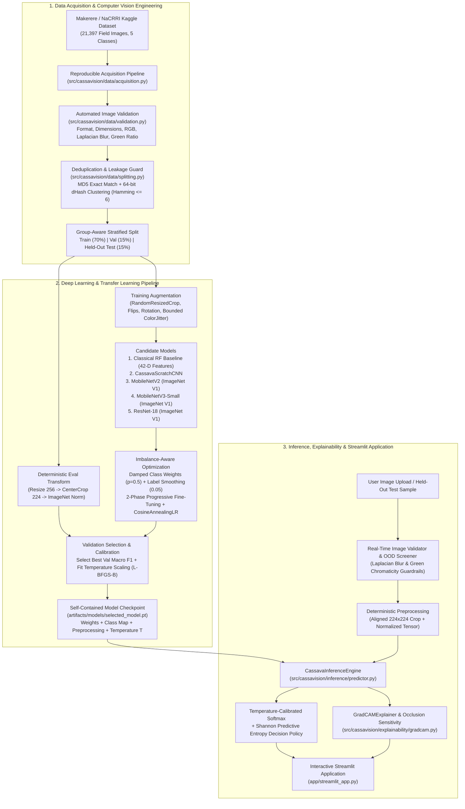
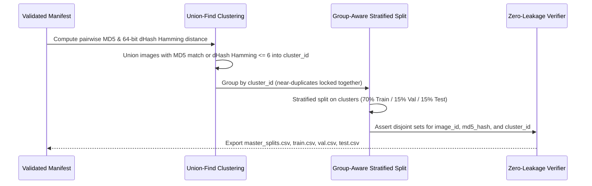

# Technical Architecture Document — CASSAVISION

## 1. System Overview & Architectural Philosophy

**CASSAVISION** is a modular, production-grade computer vision and explainable agricultural AI platform engineered to classify cassava leaf images into five canonical condition categories (`CBB`, `CBSD`, `CGM`, `CMD`, and `Healthy`) while providing calibrated probability estimates, out-of-distribution (OOD) image-quality guardrails, and post-hoc visual explanations via Gradient-weighted Class Activation Mapping (**Grad-CAM**) and perturbation-based **Occlusion Sensitivity**.

The codebase strictly separates **offline experimental training** from **online deterministic inference**, ensuring that the user-facing Streamlit application never retrains models on launch, never leaks data between partitions, and loads self-contained checkpoints encapsulating weights, class mappings, preprocessing statistics, and calibration temperatures.

---

## 2. End-to-End System Architecture (Mermaid)

---

## 3. Component-by-Component Engineering Breakdown

### 3.1 Configuration & Canonical Class Mapping (`src/cassavision/config.py`)
- Centralizes all hyperparameters in `configs/default.yaml`.
- Establishes an immutable 5-class dictionary (`CANONICAL_CLASS_MAP`) mapping indices `0..4` to their exact Makerere / NaCRRI Kaggle definitions:
  - `0`: **Cassava Bacterial Blight (`CBB`)** — *Xanthomonas axonopodis pv. manihotis*
  - `1`: **Cassava Brown Streak Disease (`CBSD`)** — *Cassava brown streak virus (CBSV / UCBSV)*
  - `2`: **Cassava Green Mottle (`CGM`)** — *Cassava green mottle virus (CGMV)*
  - `3`: **Cassava Mosaic Disease (`CMD`)** — *Cassava mosaic begomoviruses*
  - `4`: **Healthy (`Healthy`)** — Uninfected cassava foliage
- Enforces deterministic execution via `seed_everything(seed=42)` across Python `random`, `PYTHONHASHSEED`, NumPy, and PyTorch CPU/CUDA RNGs.

### 3.2 Dataset Acquisition & Provenance (`src/cassavision/data/acquisition.py`)
- Fetches the official `label_num_to_disease_map.json` and `train.csv` (21,397 rows) and verifies exact schema alignment with `CANONICAL_CLASS_MAP`.
- Selects a reproducible stratified cohort preserving the genuine natural dominance of `CMD` while guaranteeing sufficient representation ($\ge 80$ images per class) for minority categories (`CBB`, `CBSD`, `CGM`, `Healthy`).
- Downloads raw field images in parallel while keeping `data/raw/images/`, `data/processed/`, and `data/splits/` logically separated. Original images are never overwritten.

### 3.3 Automated Image Validation & Quality Diagnostics (`src/cassavision/data/validation.py`)
Every image—both during dataset ingestion and live user upload—passes through `validate_image_bytes`:
1. **Extension & Byte Integrity:** Rejects unsupported formats, 0-byte files, and truncated/corrupted buffers (`PIL.Image.verify()` + `.load()`).
2. **Dimension Guardrails:** Rejects images smaller than $32 \times 32$ or larger than $10,000 \times 10,000$.
3. **Channel Normalization:** Detects grayscale (`L`, `1`) and transparency (`RGBA`, `P`) modes, issuing explicit quality warnings and safely compositing onto 3-channel `RGB`.
4. **Optical & Chromatic Telemetry:**
   - **Luminance & Contrast:** Mean and standard deviation of grayscale intensity ($0\text{–}255$).
   - **Focus Sharpness:** Variance of the discrete $3 \times 3$ 2D Laplacian operator ($\nabla^2 I$). Values $< 15.0$ trigger a blur warning.
   - **Foliage Chromaticity Ratio:** Fraction of pixels satisfying vegetation excess-green criteria ($G > 25$, $G \ge 0.75 R$, $G \ge 1.05 B$, $2G - R - B > -15$). Values $< 5\%$ flag the input as likely Out-of-Distribution (non-leaf object).
   - **Perceptual Hashing:** Computes both MD5 byte hash and 64-bit difference hash (`dHash`) for duplicate detection.

### 3.4 Duplicate Investigation & Leakage-Free Splitting (`src/cassavision/data/splitting.py`)

### 3.5 Preprocessing, Augmentation & Class Imbalance (`src/cassavision/data/preprocessing.py`)
- **Inference / Validation / Test Transform:** Deterministic `Resize(256)` $\to$ `CenterCrop(224, 224)` $\to$ `ToTensor()` $\to$ `Normalize(mean=[0.485, 0.456, 0.406], std=[0.229, 0.224, 0.225])`.
- **Biologically Justified Training Augmentation:**
  - `RandomResizedCrop(224, scale=(0.75, 1.0))` models camera distance variation without severing all symptomatic lobes.
  - `RandomHorizontalFlip(0.5)`, `RandomVerticalFlip(0.2)`, and `RandomRotation(20°)` reflect arbitrary field leaf orientation.
  - `ColorJitter(brightness=0.15, contrast=0.15, saturation=0.10, hue=0.02)` models tropical sunlight vs. canopy shade while strictly bounding hue shift ($\le 0.02$) so healthy green chlorophyll is never artificially transformed into yellow mosaic chlorosis.
- **Imbalance Mitigation:** Computes damped inverse-frequency class weights:
  $$w_c = \frac{(N / (K \cdot n_c))^{0.5}}{\frac{1}{K}\sum_{j=1}^{K} (N / (K \cdot n_j))^{0.5}}$$
  combined with label smoothing ($\epsilon = 0.05$) in Cross-Entropy Loss.

### 3.6 Candidate Architectures & Progressive Fine-Tuning (`src/cassavision/models/` & `src/cassavision/training/`)
1. **Classical Baseline (`classical_rf_baseline`):** 250-tree Balanced Random Forest trained on a 42-dimensional vector of RGB/HSV moments, 16-bin green-red difference histogram, Excess Green Index percentiles, chlorotic ratio, and spatial Laplacian texture energy.
2. **Scratch CNN Baseline (`custom_cnn`):** 4-stage convolutional network (`32 -> 64 -> 128 -> 256` channels) with BatchNorm, ReLU, MaxPool, AdaptiveAvgPool, and Dropout classifier head.
3. **Transfer Learning Candidates (`mobilenet_v2`, `mobilenet_v3_small`, `resnet18`):**
   - Initialized with official TorchVision ImageNet-1K V1 weights (BSD-3-Clause).
   - **Phase 1 (Warmup Epochs 1–2):** Backbone frozen; newly initialized 5-class linear head trained with AdamW ($\text{lr} = 10^{-3}$) to prevent randomly initialized head gradients from corrupting pretrained convolutional filters.
   - **Phase 2 (Fine-Tuning Epochs 3+):** Full network unfrozen with discriminative learning rates ($\text{lr}_{\text{backbone}} = 2 \times 10^{-4}$, $\text{lr}_{\text{head}} = 5 \times 10^{-4}$), weight decay $10^{-4}$, gradient norm clipping ($2.0$), and `CosineAnnealingLR`.
   - Best checkpoint selected strictly by **Validation Macro F1**.

### 3.7 Calibration, Uncertainty & Explainability (`src/cassavision/evaluation/` & `src/cassavision/explainability/`)
- **Post-Hoc Temperature Scaling:** Fits scalar temperature $T > 0$ on validation logits via L-BFGS-B to minimize Negative Log-Likelihood:
  $$\hat{p}_i = \frac{\exp(z_i / T)}{\sum_{j=1}^{K} \exp(z_j / T)}$$
- **Grad-CAM (`GradCAMExplainer`):** Captures forward activations $A^k$ and backward gradients $\frac{\partial y^c}{\partial A^k}$ at the final spatial convolutional block (`features[-1]` or `layer4[-1]`), computes channel weights $\alpha_k^c = \frac{1}{H \cdot W}\sum_{u,v} \frac{\partial y^c}{\partial A_{u,v}^k}$, and projects $\text{ReLU}\left(\sum_k \alpha_k^c A^k\right)$ onto the exact $224 \times 224$ aligned crop. Computes a quantitative **Center-vs-Border Saliency Ratio** to audit whether the model attends to central leaf tissue or peripheral background.
- **Perturbation Occlusion Sensitivity:** Slides a $32 \times 32$ neutral patch across the input tensor and maps the probability drop for the target class, providing an independent non-gradient verification of spatial feature importance.
